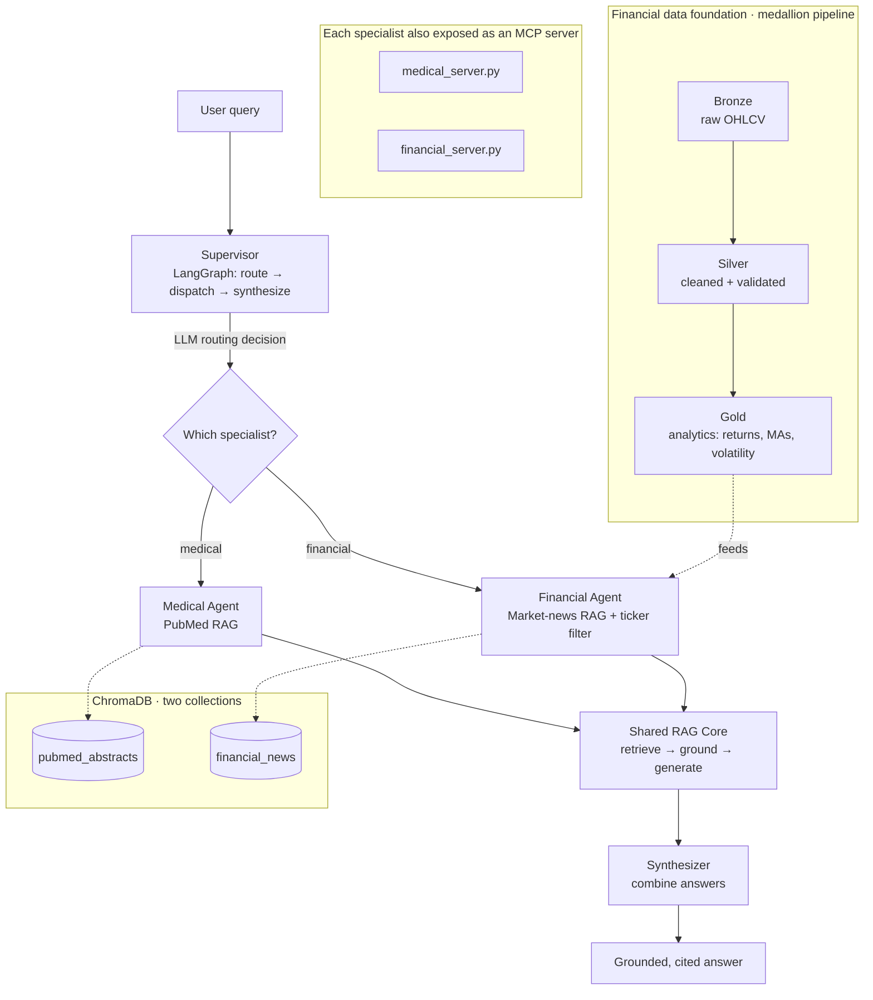

# StockSage Multi-Agent Research System

A multi-agent research assistant that routes a question to the right **specialist RAG agent** — medical or financial — each backed by its own corpus and exposed as its own **MCP server**. The financial specialist sits on a full **medallion data pipeline** built from market data.

Built to span three things in one project: **data engineering**, **retrieval-augmented generation (RAG)**, and **multi-agent orchestration**.

---

## What it does

Ask a question. A **supervisor** decides which specialist should answer, the specialist retrieves relevant sources and generates a **grounded, cited** answer, and a **synthesizer** returns the result.

- *"What are common treatments for type 2 diabetes?"* → routed to the **medical** specialist (PubMed corpus) → cited answer with PMIDs.
- *"What's happening with AI chip demand?"* → routed to the **financial** specialist (market-news corpus) → cited answer with sources, optionally scoped to a ticker.

---

## Architecture



The medical and financial specialists are each independently consumable as **MCP servers**, so any MCP client (Claude Desktop, another agent, an IDE) can use them — the supervisor is just one consumer.

---

## The two tracks

### 1. Data Engineering — medallion pipeline (the financial foundation)
A classic **bronze → silver → gold** pipeline over daily stock prices:
- **Bronze** — raw OHLCV from the yfinance API, one immutable Parquet file per ticker.
- **Silver** — cleaned and conformed: flattened columns, typed, deduplicated, and passed through a **validation gate** (null checks, OHLC sanity, range checks) that **logs rejects rather than dropping silently**.
- **Gold** — analytics computed in **DuckDB with SQL window functions**: daily returns, 7/30-day moving averages, 30-day rolling volatility, cumulative return.

Local on DuckDB + Parquet, structured so a move to cloud (S3 + Athena/Redshift) is a config change.

### 2. RAG + Multi-Agent — specialists and orchestration
- **Two RAG corpora** in one ChromaDB instance (separate collections): PubMed abstracts (medical) and financial news (financial).
- **A shared RAG core** — both specialists run the same retrieve → ground → generate logic, differing only by collection and domain prompt.
- **A LangGraph supervisor** — routes a query to a specialist via a live LLM decision, dispatches, and synthesizes.
- **Metadata-filtered retrieval** — the financial specialist can scope retrieval to a single ticker.
- **MCP servers** — each specialist exposed as a typed tool for any MCP client.

---

## Tech stack

| Layer | Technologies |
|---|---|
| Orchestration | LangGraph, LangChain |
| LLM | Claude (Anthropic) |
| Embeddings / Vector store | OpenAI `text-embedding-3-small`, ChromaDB (cosine / HNSW) |
| Data engineering | DuckDB, Parquet, pandas |
| Data sources | yfinance (prices), Finnhub (news), PubMed (abstracts) |
| Tooling / protocol | MCP (Model Context Protocol) servers |

---

## Project structure

```
stocksage-multi-agent/
├── ingestion/
│   ├── fetch_prices.py        # prices → bronze (yfinance)
│   └── fetch_news.py          # news → bronze (Finnhub)
├── pipeline/
│   ├── prices_silver.py       # bronze → silver (clean + validate)
│   └── prices_gold.py         # silver → gold (window-function analytics, DuckDB)
├── rag/
│   ├── rag_core.py            # shared retrieve → ground → generate
│   ├── build_news_index.py    # financial news → ChromaDB
│   └── build_medical_index.py # PubMed abstracts → ChromaDB
├── agents/
│   ├── financial_agent.py     # financial specialist (news + ticker filter)
│   └── medical_agent.py       # medical specialist (PubMed)
├── supervisor/
│   ├── supervisor_graph.py    # LangGraph: route → dispatch → synthesize
│   └── state.py               # shared graph state
├── mcp_servers/
│   ├── financial_server.py    # financial specialist as an MCP server
│   └── medical_server.py      # medical specialist as an MCP server
├── data/
│   ├── bronze/ silver/ gold/  # medallion layers (Parquet)
│   └── chroma_db/             # vector store (two collections)
└── config.py                  # tickers, paths, settings
```

---

## How it works (the flow)

1. **Route** — the supervisor reads the query and the specialists' descriptions, and an LLM decides which specialist fits (medical vs financial).
2. **Dispatch** — the chosen specialist runs its RAG core: retrieve top-k relevant sources, ground the prompt in them, generate a cited answer.
3. **Synthesize** — combine into one final response (pass-through for a single specialist; merge when fanned out to several).

Grounding comes from the system prompt constraining the model to the retrieved sources with citations — not from temperature.

---

## Setup

```bash
# 1. install
pip install -r requirements.txt

# 2. configure keys in .env
OPENAI_API_KEY=...        # embeddings
ANTHROPIC_API_KEY=...     # generation
FINNHUB_API_KEY=...       # news ingestion

# 3. build the data + indexes
python ingestion/fetch_prices.py
python pipeline/prices_silver.py
python pipeline/prices_gold.py
python ingestion/fetch_news.py
python rag/build_news_index.py
python rag/build_medical_index.py

# 4. run the multi-agent supervisor
python supervisor/supervisor_graph.py

# 5. or run a specialist as an MCP server
mcp dev mcp_servers/financial_server.py
```

---

## Design decisions

- **Medallion separation** — immutable raw (bronze) means a bug in downstream logic never corrupts source data; layers are re-derivable without re-fetching.
- **Validation gate with logged rejects** — data-quality failures are logged by reason, not silently dropped.
- **Shared RAG core** — the second specialist was the moment to factor out common logic; specialists differ only by corpus and prompt.
- **Fan-out ready** — the supervisor carries a *list* of routes and the synthesizer handles multiple answers, so routing to several specialists is a config change, not a rewrite.
- **MCP servers** — specialists are independently consumable typed tools, making the system composable and extensible to new domains.
- **Project-root path anchoring** — paths resolve from the config module's location, so scripts are location-independent.

---

## Roadmap

- Classifier-based routing with LLM fallback (cost optimization over pure-LLM routing)
- Fan-out: route cross-domain queries to multiple specialists and synthesize
- Tighter news relevance filtering at ingestion
- A React front end over the supervisor

---

*A self-directed project exploring production-style data engineering, RAG, and agentic orchestration.*
